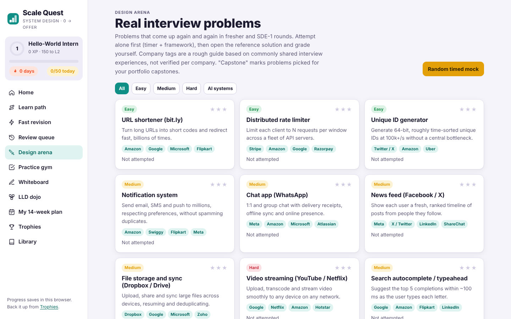

# Scale Quest

**▶ Try it live: https://bharathisen.github.io/System-Design/** (no sign-up, works offline once loaded)


A game-style site for learning system design, from zero to fresher (SDE-1) interview level. It is one HTML file with no backend and no install, and it covers both high-level design (HLD) and low-level design (LLD). You earn XP, levels, badges and a daily streak as you study.

- **Offline copy:** open `scale-quest.html` in any modern browser.

## What's inside

| Section | What it does |
|---|---|
| **Home** | XP ring for today's goal, streak and week dots, 3 daily quests, today's Learn path task, study heatmap, reviews-due banner |
| **Learn path** | One game map that combines the 14-week plan (Mon 16 Nov 2026 to Sun 21 Feb 2027) with all 42 topics and 21 problems. It has 120 levels in 14 stages: lessons, missions, boss problems, practice, checkpoints, side quests and bonus bosses. Each topic appears once, as a lesson on the first day that teaches it; later days that revisit it are missions with their own task. Every stage ends in a chest worth +100 XP. Lessons carry the colour of their world (Foundations, Networking & APIs, Data & Storage, Async & Reliability, Distributed Systems, Interview Craft, Low-Level Design, AI System Design), and a world-progress strip tracks all 8. Each topic opens with a beginner-friendly "Start here" box (plain-English explanation with an everyday analogy, plus the new words it uses), then interview-depth notes where jargon has tap-to-explain meanings, an architecture diagram, a real-world example, lines to say in the interview, traps, sources, and a "boss check" quiz that clears it |
| **Fast revision** | Cram sheets with 5 tabs: topics by module, all design problems, LLD (SOLID, core patterns, how to run the round), numbers to know, and a searchable A–Z glossary of 250+ terms. Self-test mode blurs each card until you tap it |
| **Review queue** | Spaced repetition for topics. A cleared topic comes back after 1, 3, 7, 16 and 35 days. Passing pushes it further out; missing brings it back tomorrow. Passing the 35-day review marks it Mastered |
| **Design arena** | 21 interview problems (URL shortener, rate limiter, chat, news feed, Uber, Ticketmaster, payments, RAG Q&A, LLM gateway and more). Each has a brief, a timer, hints, and a full solution covering requirements, estimates, API, diagram, deep dives, mistakes and follow-ups. You grade yourself with a 16-point rubric |
| **Practice gym** | Quiz blitz with combos, 86 flashcards (Leitner boxes), an estimation gym (QPS, storage, bandwidth, cache, servers), 45-minute timed mocks with phase checkpoints, and scorecards that chart your trend |
| **Whiteboard** | An embedded Excalidraw with an architecture stencil, a practice frame, the reference diagram for each problem, autosave, a timer and PNG export |
| **LLD dojo** | OOP and SOLID, a design patterns table with code, a guide to running the round, 6 worked problems, and a 38-problem ladder |
| **Trophies** | 40 badges, the level ladder, settings (daily goal, theme), and backup or restore of your progress |
| **Library** | Curated outside resources |



## How the game works

- **XP for each activity:**

  | Activity | XP |
  |---|---|
  | Clear a topic | 50 |
  | Revise a topic | 10 |
  | Review passed / missed | 15 / 5 |
  | Correct quiz answer (more on a combo) | 10–15 |
  | Flashcard | 2 |
  | Estimation drill hit | 15 |
  | Learn path level (mission, practice, checkpoint) | 30 |
  | Stage chest | 100 |
  | LLD problem | 30 |
  | Whiteboard save | 40 |
  | Problem attempt | 100 + rubric |
  | Mock | 150 + rubric |
  | Module revised | 20 |
  | All daily quests done | +75 bonus |

- **Levels:** 13 titles, from *Hello-World Intern* to *Distributed Legend*.
- **Streak:** hit your daily XP goal (30, 50, 100 or 150) to keep it going. You earn a streak freeze every 7 days and can hold up to 2. A freeze covers a missed day automatically.

## Your progress

Progress lives in your browser's `localStorage` (key `scalequest.v1`), so it stays on that device and in that browser only. To move it to another device, or to keep it safe, go to **Trophies → Copy backup code** and paste the code somewhere. **Restore from code** brings it back.

The live artifact and the local file count as different sites, so each keeps its own progress.

## Project layout

```
System Design/
├── scale-quest.html          # built, standalone copy (open this)
├── README.md
├── .claude/launch.json       # local preview server (port 8765)
└── scale-quest/
    ├── build.sh              # concatenates src/ into the two outputs
    ├── artifact/index.html   # built page body used for the published artifact
    └── src/
        ├── shell.html        # <title>, fonts, all CSS (light + dark tokens)
        ├── body.html         # app skeleton: sidebar, top bar, view, tab bar
        ├── data-plan.js      # 14-week planner (phases, weeks, days)
        ├── data-topics1-3.js # worlds + 42 topics (notes, diagrams, quizzes)
        ├── data-problems.js  # 21 design problems with full solutions
        ├── data-misc.js      # flashcards, LLD content, library, planner links
        ├── app.js            # engine: state, XP, levels, streak, quests,
        │                     # badges, spaced review, diagrams, routing,
        │                     # home / learn / arena views
        ├── views.js          # practice gym, LLD dojo, planner, trophies, library
        ├── revise.js         # fast revision + review queue
        ├── journey.js        # Learn path game map: plan + topics + problems
        ├── data-easy.js      # beginner layer: plain-English intros, new words,
        │                     # problem briefs, glossary
        ├── easy.js           # injects "Start here" boxes + tap-to-explain jargon
        └── wb.js             # Excalidraw whiteboard
```

## Editing and building

1. Edit files in `scale-quest/src/`.
2. Rebuild from the `scale-quest` folder:

   ```sh
   sh build.sh
   ```

   This writes `scale-quest.html` (a full document, for local use) and `scale-quest/artifact/index.html` (for the artifact).
3. Preview with hash routing working:

   ```sh
   python -m http.server 8765 --bind 127.0.0.1
   ```

   Run it from the `System Design` folder, then open http://127.0.0.1:8765/scale-quest.html.


