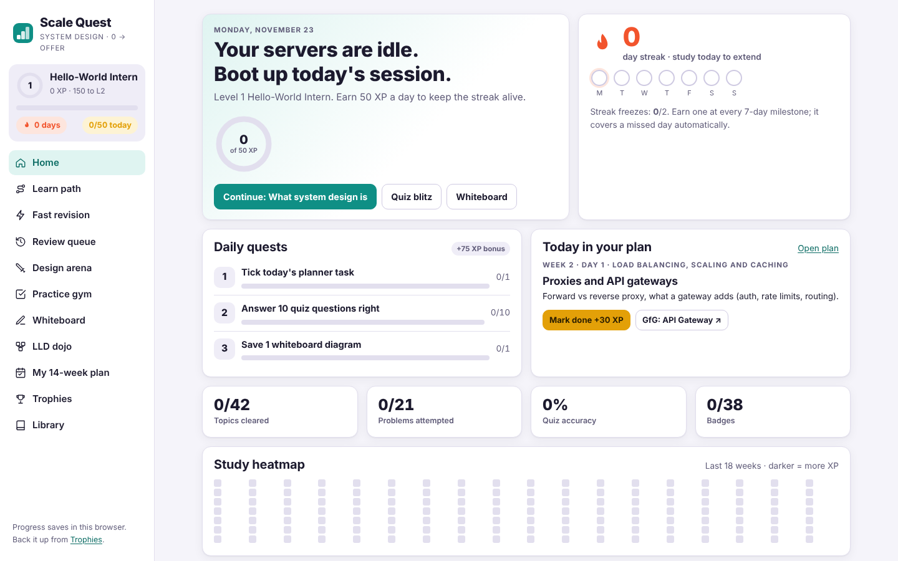

# Scale Quest

**▶ Try it live: https://bharathisen.github.io/System-Design/** (no sign-up; install it as an app and it works offline)



A game-style site for learning system design, from zero to fresher (SDE-1) interview level. It is one HTML file with no backend, and it covers both high-level design (HLD) and low-level design (LLD). You earn XP, levels, badges and a daily streak as you study.

- **Offline copy:** open `scale-quest.html` in any modern browser.

## What's inside

| Section | What it does |
|---|---|
| **Home** | XP ring for today's goal, streak and week dots, 3 daily quests, today's Learn path task, study heatmap, reviews-due banner, weekly report card (Sundays and Mondays), backup reminder |
| **Learn path** | One game map combining the 14-week plan (Mon 16 Nov 2026 to Sun 21 Feb 2027) with all 47 topics, 26 problems, schema/SQL labs and coding katas: **147 levels in 14 stages**. Each topic appears once, as a lesson on the first day that teaches it; later days that revisit it are missions with their own task. Every stage ends in a chest worth +100 XP, and lessons carry the colour of their world. Each topic opens with a beginner-friendly "Start here" box (plain-English explanation, everyday analogy, new words), then interview-depth notes with tap-to-explain jargon, a diagram, a real-world example, a **real engineering story** (a checked link to a company blog post or paper), lines to say, traps, sources and a 7-question boss quiz |
| **Fast revision** | Cram sheets with 5 tabs: topics by module, all design problems, LLD, numbers to know (modern latency figures next to the classic 2009 list), and a searchable A–Z glossary. Self-test mode blurs each card until you tap it |
| **Review queue** | Spaced repetition for topics (back after 1, 3, 7, 16 and 35 days; a miss brings it back tomorrow), a **mistakes notebook** (every wrong quiz, review or flashcard answer comes back the next day until you get it right twice) and **problem redos** (each attempted problem returns after 7, then 21 days, to redo from a blank page) |
| **Design arena** | 26 interview problems, including food delivery, e-commerce checkout, hotel booking, Google Docs-style editing and nearby search. Each has a plain-words brief, a timer, hints and a full solution (requirements, estimates, API, diagram, deep dives, mistakes, follow-ups). Grade yourself with a 16-point rubric. The practice space has a **walkthrough recorder** and optional **interviewer interruption cards** |
| **Practice gym** | Quiz blitz with combos, 86 flashcards, an estimation gym, 45-minute timed mocks (with recorder and interruptions), scorecards, and the **Schema & SQL lab**: 8 "design the tables" exercises with model answers, plus 12 SQL questions that run on a real SQLite database in your browser |
| **Whiteboard** | Excalidraw with an architecture stencil, a practice frame, reference diagrams, autosave, a timer, PNG export, and a **self-check** that puts your drawing next to the reference and scores which components you covered |
| **LLD dojo** | OOP and SOLID, design patterns with code, how to run the round, 6 worked problems, a 38-problem ladder, and **Code it**: 6 Python katas (LRU cache, token bucket, parking lot, vending machine, Splitwise, event bus) whose tests run in your browser |
| **Trophies** | 47 badges, the level ladder, the weekly report card, settings, backup code, **backup file download/restore**, and "install as an app" |
| **Library** | Curated outside resources plus all 47 real engineering stories |


## How the game works

- **XP for each activity:**

  | Activity | XP |
  |---|---|
  | Clear a topic | 50 |
  | Revise a topic / a module | 10 / 20 |
  | Review passed / missed | 15 / 5 |
  | Correct quiz answer (more on a combo) | 10–15 |
  | Flashcard | 2 |
  | Weak spot practised / fixed | 3 / 10 |
  | Estimation drill hit | 15 |
  | Learn path level (mission, practice, checkpoint) | 30 |
  | Stage chest | 100 |
  | Schema exercise / SQL query solved | 40 / 20 |
  | Coding kata passed / LLD ladder problem | 60 / 30 |
  | Whiteboard save / self-check item | 40 / 5 per item |
  | Spoken walkthrough reviewed / interruption handled | 20 / 5 |
  | Problem attempt | 100 + rubric |
  | Mock | 150 + rubric |
  | Problem mastered (passed its 21-day redo) | 50 |
  | All daily quests done | +75 bonus |

- **Levels:** 13 titles, from *Hello-World Intern* to *Distributed Legend*.
- **Streak:** hit your daily XP goal (30, 50, 100 or 150) to keep it going. You earn a streak freeze every 7 days and can hold up to 2.
- **Weekly report card:** a grade from your goal days, XP, lessons, attempts, review pass rate, your weakest world, and next week's focus.

## Speaking practice

The recorder records real audio on the GitHub Pages site or the local file: play it back, save it as `.webm`, and grade yourself with a checklist. Inside the claude.ai artifact, where raw microphone access isn't available, it transcribes what you say instead and shows words per minute and a filler-word count.

## Your progress

Progress lives in your browser's `localStorage` (key `scalequest.v1`; whiteboards under `scalequest.board.*`), so it stays on that device and browser only. Go to **Trophies → Download backup file** to save everything, whiteboards included, and **Restore from file** to bring it back on any device. Home reminds you if your last backup is more than 7 days old. The older copy-paste backup code still works.

The live site, the artifact and the local file count as different sites, so each keeps its own progress.

## Offline app

On GitHub Pages the site is an installable app: `manifest.webmanifest`, `sw.js` and `icons/` sit next to `scale-quest.html`. The service worker loads the page network-first, so new versions you push show up, with a cached copy when offline. CDN libraries (Excalidraw, sql.js, Pyodide, fonts) are cached after first use. On a phone, open the site in Chrome and choose **Add to Home screen** (Safari: Share → Add to Home Screen).

## Project layout

```
System Design/
├── index.html                # redirects to scale-quest.html (GitHub Pages entry)
├── scale-quest.html          # built, standalone copy (open this)
├── manifest.webmanifest      # offline app manifest
├── sw.js                     # service worker (offline cache)
├── icons/                    # app icons
├── README.md
├── docs/                     # screenshots
├── .claude/launch.json       # local preview server (port 8765)
└── scale-quest/
    ├── build.sh              # concatenates src/ into the two outputs
    ├── artifact/index.html   # built page body used for the published artifact
    └── src/
        ├── shell.html        # <title>, fonts, all CSS (light + dark tokens)
        ├── body.html         # app skeleton: sidebar, top bar, view, tab bar
        ├── data-plan.js      # 14-week plan (phases, weeks, days)
        ├── data-topics1-4.js # worlds + 47 topics (notes, diagrams, quizzes)
        ├── data-quiz2.js     # 4 extra scenario questions per original topic
        ├── data-problems.js, data-problems2.js  # 26 design problems
        ├── data-misc.js      # flashcards, LLD content, library, plan links
        ├── data-schema.js    # schema exercises, SQL seed data and questions
        ├── data-katas.js     # Python katas: spec, starter, tests, solution
        ├── data-easy.js, data-easy2.js  # beginner intros, new words, briefs, glossary
        ├── app.js            # engine: state, XP, levels, streak, quests, badges,
        │                     # spaced review, diagrams, routing, home/topic/arena
        ├── views.js          # practice gym, LLD dojo, trophies, library
        ├── revise.js         # fast revision + review queue
        ├── schema.js         # Schema & SQL lab (sql.js, loaded on demand)
        ├── cases.js          # real engineering stories
        ├── weak.js           # mistakes notebook
        ├── redo.js           # problem redo reviews
        ├── speak.js          # recorder / transcript + interviewer interruptions
        ├── kata.js           # Python runner (Pyodide in a Web Worker)
        ├── backup.js         # backup file, restore, reminder, install button
        ├── report.js         # weekly report card
        ├── journey.js        # Learn path game map
        ├── easy.js           # "Start here" boxes + tap-to-explain jargon
        ├── wb.js             # Excalidraw whiteboard
        └── wbcheck.js        # whiteboard self-check
```

## Editing and building

1. Edit files in `scale-quest/src/`.
2. Rebuild from the `scale-quest` folder:

   ```sh
   sh build.sh
   ```

   This writes `scale-quest.html` (full document with the offline-app tags) and `scale-quest/artifact/index.html` (for the artifact).
3. Preview with hash routing working:

   ```sh
   python -m http.server 8765 --bind 127.0.0.1
   ```

   Run it from the `System Design` folder, then open http://127.0.0.1:8765/scale-quest.html.

When you push to GitHub, include `scale-quest.html`, `manifest.webmanifest`, `sw.js`, `icons/` and `scale-quest/`.

## Sources and accuracy

Content is built from your 14-week plan and: GeeksforGeeks, Hello Interview, AlgoMaster, awesome-low-level-design, system-design-notes, the *Mastering System Design* Udemy course, and the engineering blogs linked in each topic (all links were checked to load on 23 Nov 2026). Company tags on problems are a rough guide from commonly shared interview experiences, not verified per company; "Capstone" marks problems picked for portfolio projects.
